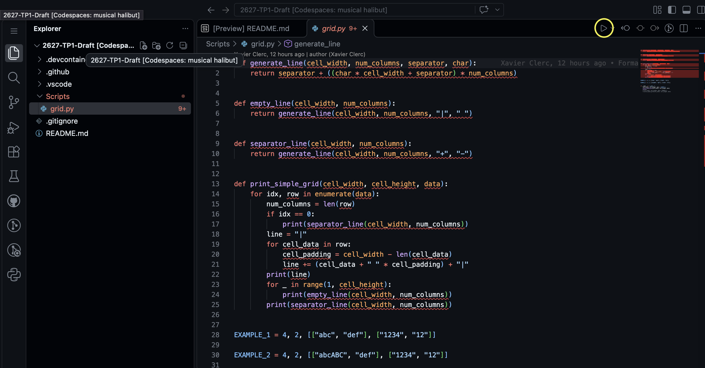
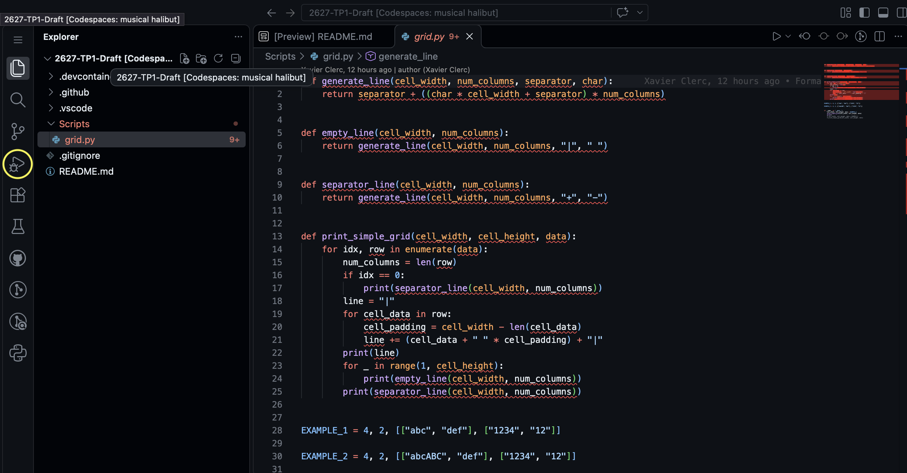
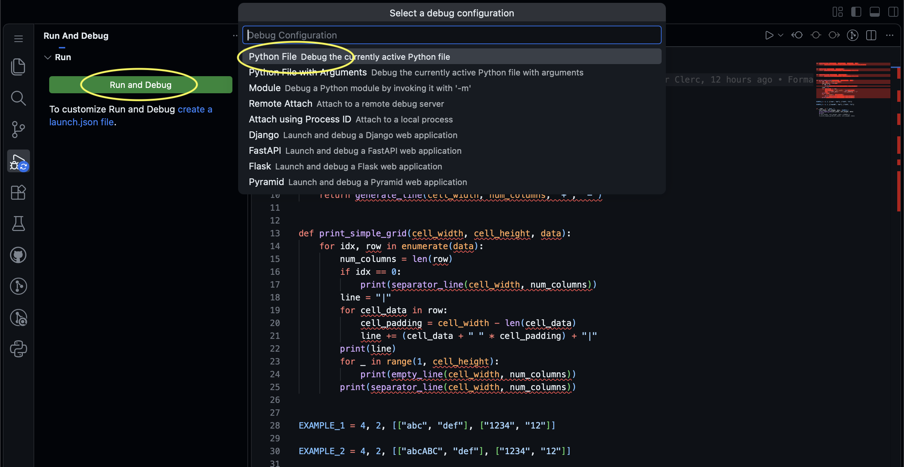
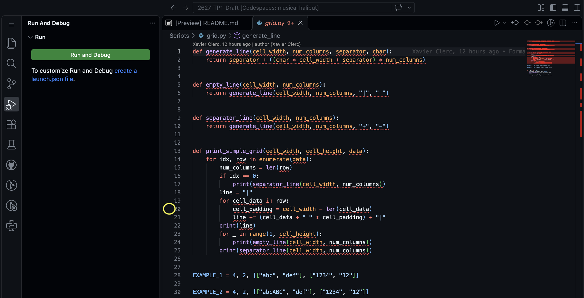
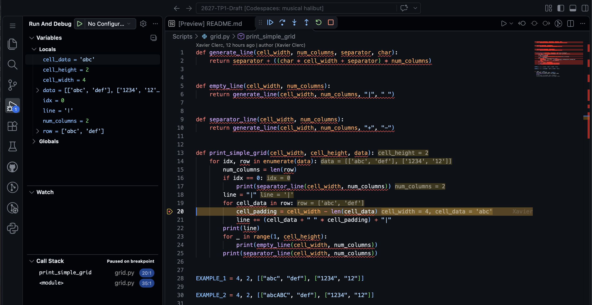
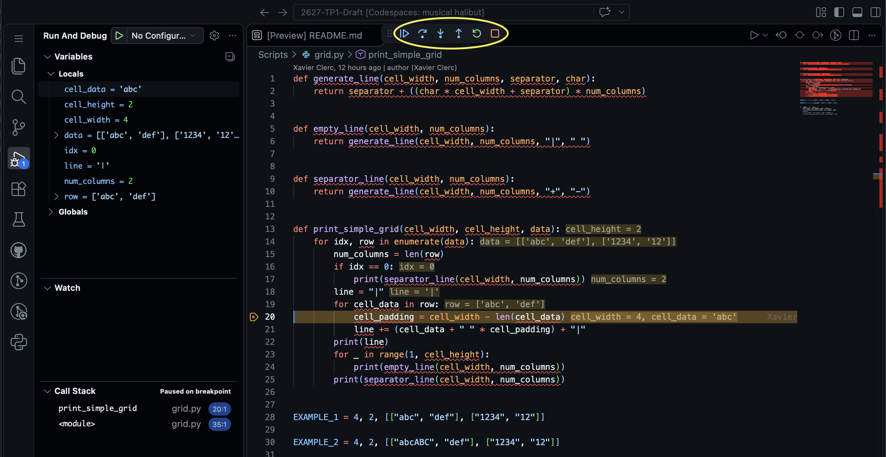
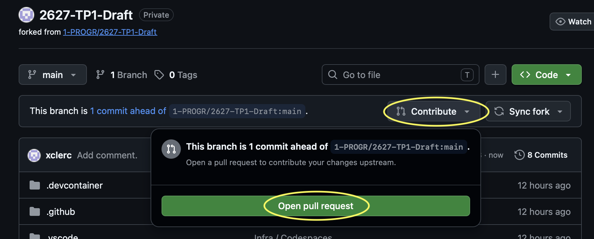
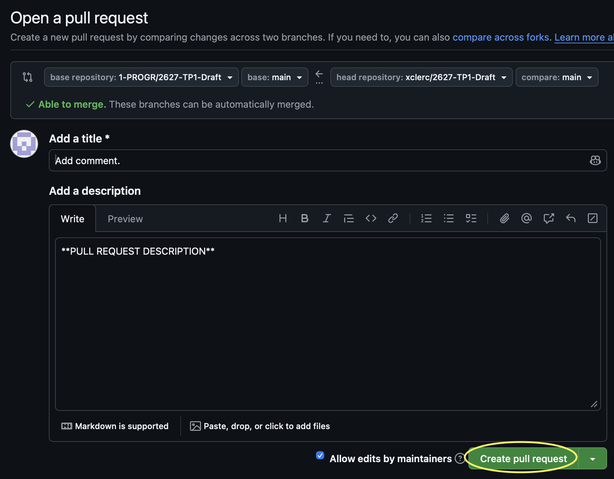
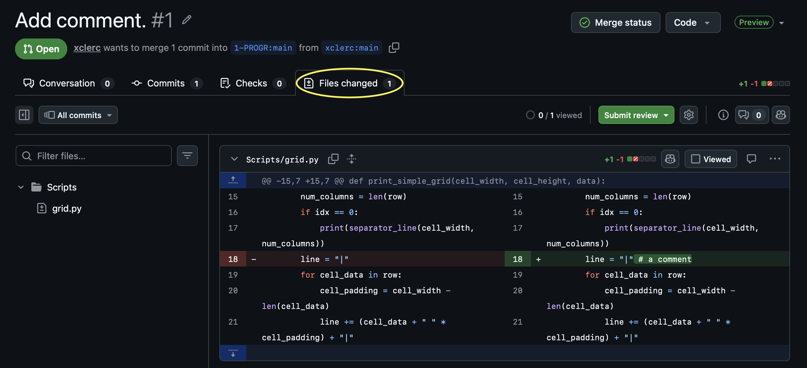

[English version below]

# Édition et exécution de scripts

Lors du *bootcamp*, nous avons commencé à explorer l'interface de VS Code afin
de versionner des fichiers. Lors de cette séance, nous allons nous concentrer
sur la modification et l'exécution de scripts Python, et sur l'ouverture d'une
*pull request* afin de partager les modifications.


## Étape 1 - exécution

Le fichier [Scripts/grid.py](./Scripts/grid.py) contient une fonction nommée
`print_simple_grid` qui affiche de manière textuelle une grille. Les paramètres
permettent de contrôler les largeur et hauteur des cases de la grille, et de
spécifier le contenu des cases. Par exemple, si la fonction est appelée avec les
valeurs `4`, `2`, et `[["abc", "def"], ["1234", "12"]]`, alors l'affichage
produit est :

```
+----+----+
|abc |def |
|    |    |
+----+----+
|1234|12  |
|    |    |
+----+----+
```

La première étape consiste à exécuter le script. L'exécution peut se faire
depuis le terminal, via un appel à la commande `python` suivie du chemin du script,
ou depuis l'interface graphique :




## Étape 2 - débugage et mise au point

La seconde étape consiste à modifier le programme afin de corriger des bugs. En
effet, si une chaîne est trop longue par rapport à la largeur spécifiée,
l'affichage produit ne sera pas satisfaisant. On peut le vérifier en changeant la
valeur du dernier paramètre en `[["abcABC", "def"], ["1234", "12"]]`.

On va donc chercher à exécuter le programme différemment pour déterminer le
problème. Sur la gauche de l'interface, on peut accéder à l'interface de
débugage :



puis cliquer sur "Run and Debug" et sélectionner "Python File" :



Une fonctionnalité très utile du debugger est la possibilité de placer des
*break points* (ou points d'arrêt). Cela se fait en cliquant à l'extrême gauche
d'une ligne dans le panneau d'édition :



Les *break points* sont matérialisés par des disques rouges et, comme leur nom
l'indique, ils vont stopper l'exécution du debugger. Ainsi, si l'on relance le
debugger, on obtient :



qui montre l'exécution suspendue et permet de consulter les valeurs des
variables. La barre d'exécution permet de choisir comment procéder : on peut
continuer l'exécution jusqu'à la fin du programme ou au prochain *break point*,
exécuter pas-à-pas (c'est-à-dire instruction par instruction), ou encore stopper
l'exécution :



Sur le panneau de gauche, outre les variables, on peut consulter la *call stack*
(pile des appels) qui montre les appels de fonctions imbriqués, et définir des
*watches* qui sont simplement des expressions qui sont évaluées à partir des
valeurs des variables.

Tous ces éléments sont extrêmement utiles à la mise au point d'un programme et à
la l'investigation de bugs. Il est donc recommandé de se familiariser avec ces
mécanismes.

Corriger le script en tronquant la chaîne de caractères de telle sorte que
l'alignement de la grille soit toujours respecté, quelles que soient les
longueurs des chaînes de caractères.

On peut également modifier la fonction pour supporter le cas où les listes
imbriquées décrivent une grille non rectangulaire.


## Étape 3 - sauvegarde et partage des modifications

Tous les changements apportés aux fichiers dans VS Code en ligne sont éphémères
(*i. e.* seront perdus lorsque la machine virtuelle sera détruite). Pour les
sauvegarder de manière durable, il faut non seulement effectuer un `git commit`,
mais également un `git push` afin de "pousser" les modifications vers le dépôt.

Une fois que les modifications ont été poussées, elles sont visibles sur la page
web du dépôt. Pour les partager (par exemple pour rendre un TP), il est
possible d'ouvrir une *pull request* en cliquant sur "Contribute" puis
"Open pull request" :



Vous pouvez alors confirmer la création de la *pull request* :



et consulter son *diff* :




## (Optionnel) Étape 4 - extensions

Une première modification utile du programme serait de permettre à chaque case
de contenir plusieurs lignes de texte. Ainsi, dans la nouvelle version de
`print_grid`, si l'on passe les valeurs `4`, `2`, et
`[[["abc", "..."], ["def","~~~"]], [["1234", ""], ["12", "34"]]]`, alors
l'affichage produit est :

```
+----+----+
|abc |def |
|... |~~~ |
+----+----+
|1234|12  |
|    |34  |
+----+----+
```

Une seconde modification serait de centrer horizontalement le contenu des
cellules, et de contrôler le caractère représentant l'absence de donnée (le
caractère espace étant utilisé jusqu'ici). La dernière version de la fonction,
recevant en paramètres les valeurs `6`, `2`, `"!"` et
`[[["abc", "..."], ["def","~~~"]], [["1234", ""], ["12", "34"]]]`, produirait
par exemple l'affichage suivant :

```
+------+------+
|!abc!!|!def!!|
|!...!!|!~~~!!|
+------+------+
|!1234!|!!12!!|
|!!!!!!|!!34!!|
+------+------+
```

Pour partager les modifications additionnelles, il suffit d'effectuer un
*commit* et un *push*. En effet, la *pull request* est automatiquement
synchronisée avec le contenu de la branche à partir de laquelle elle a été
créée.


# Editing and executing scripts

During the bootcamp, we have started the exploration of the VS Code interface in
order to use commands related to version control. During this session, we will
focus on the edition and execution of Python scripts, and on the creation of a
pull request in order to share the changes made to files.


## Step 1 - executing

The [Scripts/grid.py](./Scripts/grid.py) file contains a function, namely
`print_simple_grid`, which displays a grid as bare text. The parameters allow the
caller to control the width and height of the cells, and to specify the text
they contain. For instance, if the function is called with the values `4`, `2`,
and `[["abc", "def"], ["1234", "12"]]`, then the produced output is:

```
+----+----+
|abc |def |
|    |    |
+----+----+
|1234|12  |
|    |    |
+----+----+
```

The first step is to execute the script. The execution can be launched from the
terminal, using the `python` command followed by the path to the script, or by
using the GUI:


## Step 2 - debugging

The second step is to change the program in order to fix bugs. Indeed, if a
string is too long relatively to the passed width, the output will not be
satisfying. We can double check that by changing the value of the last parameter
to `[["abcABC", "def"], ["1234", "12"]]`.

We will thus execute the program in a different way in order to investigate the
issue. On the left of the interface, we can open the debugging panel:


then click on "Run and Debug", and choose "Python File":


A very useful feature of the debugger is the ability to set break points. It can
be done by clicking on the left of a line in the editing panel:


The *break points* are represented using red circles and, as their name
suggests, they will stop the execution of the debugger. If we launch the
debugger again, we get:


which shows that the execution is suspended, allowing us to check the values of
the variables. The execution bar can be used to choose how to continue the
execution: for instance, until the end of the program or next break point, step
by step (*i.e.* statement after statement). It is also possible to stop the
execution:


On the debugging panel, in addition to the variables, we can see the call stack,
which shows nested function calls, and define watches, which are simply
expressions evaluated using the values of the variables.

All these elements are very useful to understand issues and debug programs. It
is thus worthwhile to get familiar with these mechanisms.

Fix the script by truncating the string so that the grid alignment is always
correct, independently of the string lenths.

It is also possible to modify the function to support the cases where the nested
lists describe a non-rectangular grid.


## Step 3 - saving and sharing

All the changes made to files in the online version of VS Code are ephemeral
(*i.e.* will be lost when the virtual machine will shut down). In order to
properly saves our changes, we have to `git commit` the changes *and also*
execute `git push` to "push" the changes to the repository.

Once the changes have been pushed, they can be seen on the web page of the
repository. In order to share them (for instance to submit your work at the end
of a session), you can open a *pull request* by clicking "Contribute" and then
"Open pull request":


You can then confirm you want to create a pull request:


and check its *diff*:


## (Optional) Step 4 - extensions

A first useful extension would be to support multiple strings in the same cell.
The new version of the `print_grid` function, when receiving the values `4`,
`2`, and `[[["abc", "..."], ["def","~~~"]], [["1234", ""], ["12", "34"]]]`,
would then produce the following output:

```
+----+----+
|abc |def |
|... |~~~ |
+----+----+
|1234|12  |
|    |34  |
+----+----+
```

Another extension would be to center (horizontally) the contents of the cells,
and to control the character used when no data is available (the space character
was implicitly used so far). The last version of the function, when receiving
the values `6`, `2`, `"!"` and
`[[["abc", "..."], ["def","~~~"]], [["1234", ""], ["12", "34"]]]`, would
produce the following output:

```
+------+------+
|!abc!!|!def!!|
|!...!!|!~~~!!|
+------+------+
|!1234!|!!12!!|
|!!!!!!|!!34!!|
+------+------+
```

In order to share the additional changes, it is enough to commit and push
the changes. Indeed, the pull request is automatically synchronized with
the contents of the branch used to create it.
